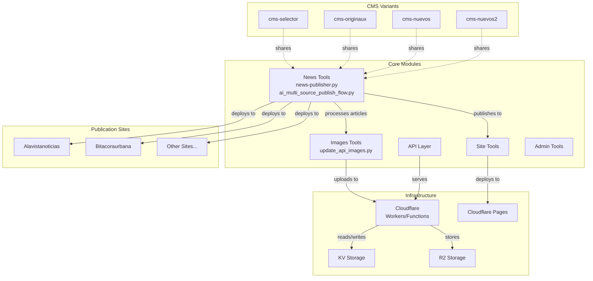

# cloudflare-news-project Architecture

## Overview

This is a multi-site news publication automation system built on Cloudflare Workers/Pages. The project manages multiple news sites (cms-selector, cms-originaux, cms-nuevos, cms-nuevos2) with shared tools for news processing, image management, API endpoints, and site deployment.

**Statistics:**
- 3,334 files
- 10,600 code symbols
- 22,896 relationships
- 940 communities (functional areas)
- 300 execution flows

## Functional Areas

### Core Modules

| Module | Purpose | Key Files |
|--------|---------|-----------|
| **News** | Article paraphrasing, publishing, content normalization | news-publisher.py, ai_multi_source_publish_flow.py |
| **Images** | API image management, updates, processing | update_api_images.py |
| **Api** | REST endpoints, data handling | Various API handlers |
| **Site** | Site configuration, deployment scripts | tools/site/* |
| **Admin** | Administrative functions, batch operations | admin tools |
| **Functions** | Cloudflare Workers functions | functions/* |
| **Scripts** | Utility scripts for automation | scripts/* |

### CMS Variants (3 Independent Workers)

Each CMS runs as an **independent Cloudflare Worker** with its own infrastructure:

```
┌─────────────────────────────────────────────────────────────────────────┐
│                    NEXOPRESS PORTAL                                   │
│              (nexopress.sebastianvernis.space)                        │
│                    Entry Point / Router                               │
└─────────────────────────────────────────────────────────────────────────┘
                                  │
        ┌─────────────────────────┼─────────────────────────┐
        ▼                         ▼                         ▼
┌───────────────────┐    ┌───────────────────┐    ┌───────────────────┐
│  CMS ORIGINAUX    │    │   CMS NUEVOS      │    │  CMS NUEVOS 2     │
│  (cms-originaux)  │    │  (cms-nuevos)     │    │  (cms-nuevos2)   │
│                   │    │                   │    │                   │
│  • Worker        │    │  • Worker         │    │  • Worker         │
│  • D1 Database   │    │  • D1 Database    │    │  • D1 Database    │
│  • KV Storage    │    │  • KV Storage     │    │  • KV Storage     │
│  • R2 (images)  │    │  • R2 (images)    │    │  • R2 (images)    │
│                   │    │                   │    │                   │
│  10 SITIOS        │    │  17 SITIOS        │    │  8 SITIOS         │
└───────────────────┘    └───────────────────┘    └───────────────────┘
        │                         │                         │
        └─────────────────────────┼─────────────────────────┘
                                  ▼
┌─────────────────────────────────────────────────────────────────────────┐
│                 CLOUDFLARE PAGES (35 Static Sites)                     │
│   Each site: Frontend + SSR Functions + Custom Domain                   │
└─────────────────────────────────────────────────────────────────────────┘
```

**Site Distribution:**

| CMS | Worker URL | Sites Count |
|-----|------------|--------------|
| **CMS Originaux** | `cms-originaux.sebastianvernis.workers.dev` | 10 |
| **CMS Nuevos** | `cms-nuevos.sebastianvernis.workers.dev` | 17 |
| **CMS Nuevos 2** | `cms-nuevos2.sebastianvernis.workers.dev` | 8 |

**Total: 35 independent news sites**

- Each Worker manages its own articles, users, and Facebook publishing
- Each has its own D1 database, KV namespace, and R2 bucket
- Shared: R2 for images (common pool), Portal for unified access

### Key Communities (by Symbol Count)

| Community | Symbols | Cohesion | Description |
|-----------|---------|----------|-------------|
| Fixes | 236 | 1.00 | Bug fixes and patches |
| Js | 172 | 0.84 | JavaScript utilities |
| Admin | 77 | 0.90 | Admin operations |
| News | 70 | 0.80 | News processing |
| Api | 51 | 0.95 | API layer |
| Functions | 38 | 0.97 | Cloudflare Functions |

## Key Execution Flows

### Top Processes (by Step Count)

All top processes have 5 execution steps:

1. **Main → Normalize_article** - Article content normalization
2. **Main → Print_summary** - Summary generation
3. **Main → Clean_text** - Text cleanup
4. **Main → Rewrite_title** - Title rewriting
5. **Main → Rewrite_description** - Description rewriting

### Entry Point

```
Function: cms-selector/tools/news/ai_multi_source_publish_flow.py:main (line 964)
```

This is the main entry point for the multi-source publish flow that orchestrates article processing across all CMS variants.

### Key Classes

- **NewsParaphraser** - Handles article paraphrasing
- **NewsPublisher** - Manages article publishing workflow

## Architecture Diagram



## Data Flow

```
┌─────────────┐     ┌──────────────┐     ┌─────────────┐
│ News Source │────>│ Normalize    │────>│ Paraphrase  │
└─────────────┘     └──────────────┘     └─────────────┘
                                                 │
                     ┌──────────────┐            │
                     │ Clean Text   │<───────────┘
                     └──────────────┘
                          │
        ┌─────────────────┼─────────────────┐
        ▼                 ▼                 ▼
┌─────────────┐   ┌─────────────┐   ┌─────────────┐
│ Rewrite     │   │ Print       │   │ Update      │
│ Title       │   │ Summary     │   │ Images      │
└─────────────┘   └─────────────┘   └─────────────┘
        │                 │                 │
        └─────────────────┼─────────────────┘
                          ▼
                 ┌─────────────┐
                 │ Publish to  │
                 │ Site        │
                 └─────────────┘
```

## Technology Stack

- **Runtime**: Cloudflare Workers / Cloudflare Pages
- **Language**: Python (tools), JavaScript/TypeScript (frontend)
- **Storage**: Cloudflare KV, Cloudflare R2
- **Deployment**: Wrangler CLI

## Development Notes

- Multiple CMS variants share core functionality via common tool imports
- Each publication site operates as an independent community
- Cross-community processes handle site-specific customization
- The Fixes community (236 symbols, 1.0 cohesion) indicates active maintenance
