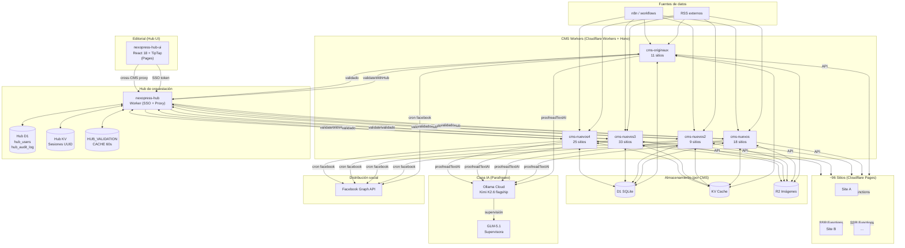

# NexoPress — Arquitectura del sistema

> Generado automáticamente con GitNexus (26 135 símbolos · 300 flujos · 4 892 archivos)
> Última actualización: 2026-06-20

---

## Visión general

**NexoPress** es una plataforma multi-sitio de noticias en español (México) desplegada
sobre el edge de Cloudflare. Orquesta ~96 sitios desde un único núcleo distribuido
sin servidor centralizado: cada CMS Worker maneja su propio grupo de sitios, su
propia base de datos D1 y sus propios crons de ingesta.

```
Fuentes RSS / n8n
      │
      ▼
┌─────────────────────────────────────────────────────────────┐
│  5 CMS Workers (Hono + D1 + KV + R2)                        │
│  cms-originaux · cms-nuevos · cms-nuevos2 · cms-nuevos3 ·   │
│  cms-nuevos4                                                 │
│  Cada Worker gestiona su grupo de sitios Pages               │
└────────────────────────┬────────────────────────────────────┘
                         │ SSO / proxy cross-CMS
                         ▼
               ┌──────────────────┐
               │  nexopress-hub   │  Worker de orquestación + SSO
               │  (D1 + KV)       │
               └────────┬─────────┘
                        │
                        ▼
               ┌──────────────────┐
               │ nexopress-hub-ui │  React 18 + TipTap (Cloudflare Pages)
               └──────────────────┘

Lectores → ~96 sitios Pages (SSR por Cloudflare Functions)
```

---

## Áreas funcionales (clusters del grafo)

| Cluster | Símbolos | Cohesión | Descripción |
|---------|----------|----------|-------------|
| **News** | 750 | 89 % | Ingesta RSS, parafraseo, gestión de artículos |
| **Admin** | 745 | 79 % | UI de administración y dashboard |
| **Site** | 371 | 91 % | Páginas y plantillas por sitio |
| **Utilities** | 213 | 92 % | Helpers compartidos (parsers, formatters) |
| **Scripts** | 186 | 99 % | Scripts de mantenimiento y migración |
| **Functions** | 177 | 100 % | Cloudflare Pages Functions (SSR de artículos) |
| **Cron** | 176 | 77 % | Jobs programados: RSS, Facebook, Ticker |
| **Js** | 99 | 79 % | JS legacy del admin (en migración a React) |
| **Api** | 74 | 95 % | Handlers de rutas API del Worker |
| **Pages** | 63 | 87 % | Componentes del Hub UI (React) |
| **Tests** | 49 | 100 % | Tests automatizados |
| _100 clusters en total_ | — | — | — |

---

## Los 5 CMS Workers

Cada Worker sigue la misma estructura interna y se diferencia solo en el grupo de
sitios que atiende y el binding a su D1.

```
cms-<nombre>/
├── src/
│   ├── routes/          # Endpoints Hono
│   │   ├── articles.js  # CRUD de artículos
│   │   ├── auth.js      # Login / logout local
│   │   ├── categories.js
│   │   ├── sitemap.js   # Sitemap XML Google News
│   │   ├── facebook.js  # Cola de publicación FB
│   │   ├── rss.js       # Feed RSS por sitio
│   │   ├── images.js    # Upload a R2
│   │   ├── jobs.js      # Estado de crons
│   │   └── ...
│   ├── cron/
│   │   ├── master.js        # Dispatcher de crons (runMasterCron)
│   │   ├── rss-ingest.js    # Ingesta y parafraseo de artículos
│   │   ├── facebook.js      # Publicación automática a Facebook
│   │   └── ticker.js        # Actualizador de ticker
│   └── middleware/
│       └── auth.js          # checkAuth + validateWithHub
├── sites/               # Assets estáticos por sitio
│   └── _shared/
│       ├── article-middleware.js  # OG tags + JSON-LD SSR
│       └── sitemap.js             # generateSitemap (Google News)
├── migrations/          # SQL idempotente para D1
├── tools/news/          # Python: rss_ingest_premium.py, news-publisher.py
└── wrangler.toml        # Bindings D1, KV, R2
```

| Worker | Sitios | DB |
|--------|--------|----|
| `cms-originaux` | 11 | `news_db_cms_originaux` |
| `cms-nuevos` | 18 | `news_db_cms_nuevos` |
| `cms-nuevos2` | 9 | `news_db_cms_nuevos2` |
| `cms-nuevos3` | 33 | `news_db_cms_nuevos3` |
| `cms-nuevos4` | 25 (en rediseño) | `news_db_cms_nuevos4` |

---

## Hub de orquestación (`nexopress-hub`)

El Hub no almacena artículos: es la capa de SSO, auditoría y proxy cross-CMS.

```
nexopress-hub (Worker)
├── D1: nexopress-hub-db
│   ├── hub_users          (usuarios + cms_access JSON[])
│   ├── hub_audit_log      (login, create, change_state)
│   └── hub_sessions → KV  (sesiones UUID)
├── KV: HUB_KV             (sesiones activas)
└── KV: HUB_VALIDATION_CACHE  (cache 60 s de tokens validados)
```

---

## Hub UI (`nexopress-hub-ui`)

Editor editorial React 18 + TipTap con panel SEO integrado.

```
nexopress-hub-ui/src/pages/
├── Login.jsx      # Autenticación → getToken
├── Dashboard.jsx  # Vista cross-CMS de artículos y estadísticas
├── Editor.jsx     # TipTap + handlePublish / handleDelete / handleDiscard
├── Articles.jsx   # Listado y filtros
├── CMS.jsx        # Gestión de sitios por CMS
├── Gallery.jsx    # Galería de imágenes R2
└── Users.jsx      # Gestión de usuarios
```

---

## Sitios (`~96 Cloudflare Pages projects`)

Cada sitio es un Pages project independiente:

```
<sitio>/
├── index.html                        # Homepage (masonry de artículos)
├── articulo/index.html               # Plantilla de artículo
├── functions/articulo/[[slug]].js    # SSR: inyecta OG + JSON-LD
├── categoria/index.html
├── style.css + style-custom.css      # Colores y logos del sitio
├── robots.txt                        # Con directiva Sitemap
├── _redirects                        # Proxy al CMS Worker
└── wrangler.toml
```

El archivo `_shared/article-middleware.js` es compartido entre todos los sitios
y se encarga de la inyección de metadatos SEO en el SSR.

---

## Flujos de ejecución clave

### 1. Login y autenticación SSO

```
Login.jsx (handleSubmit)
  └─► API Hub (/auth/login)
        └─► Hub Worker: genera UUID → HUB_KV (sesión)
              └─► Token devuelto al frontend → localStorage
```

Cada CMS valida tokens con triple fallback:
```
CMS middleware (checkAuth)
  1. KV local del CMS
  2. HUB_VALIDATION_CACHE (60 s)
  3. Request a HUB_API_URL (Hub Worker)
```

### 2. Ingesta RSS (Cron)

```
Worker Cron Trigger (cada N min)
  └─► master.js (runMasterCron)
        └─► rss-ingest.js (runRSSIngestForSite)
              ├─► Fetch feed RSS externo
              ├─► processPreScrapedArticle
              │     └─► proofreadTextAI (Ollama Cloud: Kimi K2.6)
              └─► INSERT en D1 (estado: draft / in_review)
```

Herramienta Python alternativa: `rss_ingest_premium.py` (invocada desde n8n).

### 3. Publicación de artículo

```
Editor.jsx (handlePublish)
  └─► PUT /api/articles/:id/state → CMS Worker
        ├─► Actualiza estado a "published" en D1
        ├─► Invalida KV cache del artículo
        └─► Cola de Facebook (si cumple reglas horarias)
```

### 4. Publicación automática en Facebook (Cron)

```
master.js → facebook.js (Cron diario por sitio)
  ├─► Verificar ventana horaria (08:00–22:00 hora local)
  ├─► Verificar frecuencia (≥ 3 h entre posts)
  ├─► Verificar límite diario (≤ 4 posts/día)
  └─► publish_to_facebook → Graph API (solo artículos < 48 h)
```

### 5. Generación de Sitemap XML (Google News)

```
GET /sitemap.xml → CMS Worker (intercepción por hostname)
  └─► sitemap.js (generateSitemap)
        ├─► Query D1: artículos publicados (últimas 48 h)
        └─► Respuesta XML con namespace Google News
```

---

## Diagrama de arquitectura (Mermaid)



---

## Principios de diseño invariantes

- **Un artículo vive en un solo CMS** — no hay broadcast entre Workers.
- **Despliegue en edge** — ningún servidor central; todo es Worker o Pages.
- **IA en parafraseo, no en publicación** — Ollama Cloud solo para `proofreadTextAI`; la decisión editorial es humana.
- **Migraciones aditivas** — nunca destructivas sin backup explícito.
- **Deploy-verdict del usuario** — el agente diagnostica y commitea; el usuario despliega y da veredicto final.

---

## Referencias cruzadas

| Documento | Contenido |
|-----------|-----------|
| `docs/AGENTS.md` | Directrices canónicas para agentes IA (fuente única de verdad) |
| `docs/CONTRIBUTING.md` | Convenciones de código y flujo de contribución |
| `docs/API_REFERENCE.md` | Endpoints de los CMS Workers |
| `docs/guides/` | Guías operativas: crear sitio, deploy, migraciones |
| `docs/plans/` | Planes de implementación aprobados |
| `scripts/README.md` | Índice de scripts de mantenimiento |
